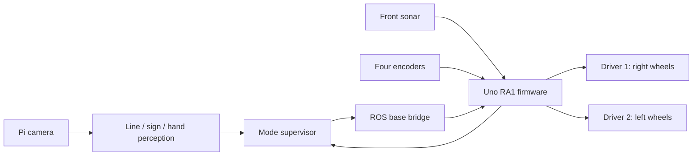

# 카메라 기반 전차형 로버 — 개발·Pi 배포본

> **2026-11-13 배선 변경:** 1번 드라이버=왼쪽 2개, 2번=오른쪽 2개이며 모터 제어는 Pi로 이동합니다. Uno는 엔코더·초음파·IR 5개를 담당합니다. 센서 핀은 초음파 A0/A1, IR 왼쪽부터 D8~D12로 계획하고 엔코더 핀은 유지합니다. Pi PWM을 같은 쪽 A/B끼리 묶는 방안은 아직 검토 중입니다. 최신 핀 계획은 [WIRING.md 상단](WIRING.md)을 기준으로 합니다. **기존 소스·펌웨어는 아직 이전 Uno 모터 제어 구성입니다. 새 배선에 맞춘 수정·검증 전에는 아래 하드웨어 실행 절차를 사용하지 않습니다.**

## 이전 구현·배포 기록 — Uno 모터 제어 구성

모터 4개, TB6612FNG 2개, Arduino Uno, Raspberry Pi 카메라, 전면 초음파 센서를 사용하는 ROS 2 Jazzy/Python 프로젝트입니다. **1번 드라이버는 오른쪽 앞·뒤, 2번 드라이버는 왼쪽 앞·뒤를 담당합니다.**

Windows 개발 후 Raspberry Pi의 `~/robot_ws`에 배포했습니다. 최초 배포 테스트는 90개, 이후 모터 벤치 시험을 추가한 최신 테스트는 **로컬과 Pi 각각 111개 통과**입니다. ROS 가상 주행/공개 참조 이미지 손 추종 통합 시험도 통과했습니다. 실제 모터 4개 구동은 아직 확인하지 못했습니다. Uno USB 미인식과 실제 카메라의 libcamera 오류가 남아 있습니다. 기본값은 `hardware.enabled: false`, `calibrated: false`, 주행 모드 `idle`입니다. 최초 Pi 배포 기록은 [DEPLOYMENT_REPORT.md](DEPLOYMENT_REPORT.md), 로컬 검증은 [DEVELOPMENT_REPORT.md](DEVELOPMENT_REPORT.md), 상세 배선은 [WIRING.md](WIRING.md)에 있습니다.

## 현재 상태와 중단 지점 — 2026-11-12

- 사용자가 모터 4개 배선 후 ROS 시험을 요청했고, 바퀴 4개를 띄우고 즉시 6V 전원을 끌 수 있다고 확인했습니다.
- `ros2 run rover_autonomy motor_bench_test`를 Pi에서 실제 실행했지만 `/dev/ttyACM0`이 없어 포트를 열지 못했습니다. **구동 명령은 전송되지 않았고 모터가 돌았다고 확인한 결과도 없습니다.**
- 다른 Pi USB 포트로 바꿔도 Uno는 `lsusb`에 없었습니다. 보드 전원 LED는 켜진다고 사용자가 알렸습니다. 전원 공급과 USB 데이터 연결은 별개입니다. USB 장치 허용 값은 1이며 로그에 새 Uno 연결 이벤트가 없었습니다. 케이블/보드/포트/외부 배선 중 원인은 아직 확정하지 않았고 Pi USB 포트 고장으로 단정하지 않습니다.
- 사용자 요청으로 Pi를 한 번 재부팅했고 재접속했지만 USB 증상은 같았습니다.
- 사용자가 전체 배선을 다시 하겠다며 대기를 요청했습니다. **현재는 하드웨어 시험을 멈춘 상태이며, 새 펌웨어를 업로드하지 않았습니다.**
- 현재 백업 작업에서는 Pi를 사용할 수 없으므로 노트북 자료를 우선 보존합니다. Pi에만 있는 전체 원본과 보드 flash/EEPROM 백업은 이번 GitHub 백업에 들어 있다고 가정하면 안 됩니다. 노트북에 내려받아 둔 검증 기록과 로그는 보존합니다.

## 이전 구성과 배선 — 최신 계획은 WIRING.md 상단 참고

Pi 4 / Ubuntu 24.04 / ROS 2 Jazzy / Uno / TB6612FNG 2개 / FIT0450 모터 4개 / 외부 모터 전원 6V 구성입니다. Pi와 Uno의 통신은 USB 시리얼이며 Uno D0/D1은 예약합니다. 현재 카메라는 OV5647로 인식됐습니다.

| 드라이버 입력 | 1번: 오른쪽 앞·뒤 | 2번: 왼쪽 앞·뒤 |
|---|---|---|
| PWMA + PWMB | 둘 다 D3 | 둘 다 D5 |
| AIN1 + BIN1 | 둘 다 D9 | 둘 다 D11 |
| AIN2 + BIN2 | 둘 다 D8 | 둘 다 D12 |
| STBY | D10 | D10 |

위 쌍은 **각 드라이버 안에서 입력만** 묶습니다. 좌우 PWM/방향은 독립입니다. 1번 AO1/AO2는 오른쪽 앞, BO1/BO2는 오른쪽 뒤 모터에 연결하고 2번은 같은 순서로 왼쪽 앞·뒤를 연결합니다. 출력끼리는 묶지 않습니다. 모터 설치 방향에 따라 구동선 두 개를 바꿔 전진 방향을 맞춰야 합니다.

| 전원 | 연결 |
|---|---|
| 두 드라이버 VCC | Uno 5V |
| 두 드라이버 VM | 외부 6V + |
| 두 드라이버 GND | 외부 전원 − 및 Uno GND와 공통 |
| 엔코더 VCC/GND | 규격 확인 후 5V/공통 GND |

외부 6V를 Uno 5V 핀에 넣지 않습니다. 배선할 때 USB와 모터 전원을 모두 분리합니다. 엔코더 단자 순서는 아직 실물 확인 전이므로 색상만으로 연결하지 않습니다.

| 엔코더 위치 | A상 | B상 |
|---|---|---|
| 왼쪽 앞 LF | D2 | D4 |
| 오른쪽 앞 RF | D6 | D7 |
| 왼쪽 뒤 LR | A3 | A4 |
| 오른쪽 뒤 RR | A2 | A5 |

초음파는 TRIG=A0, ECHO=A1이며 실제 모델/전압은 확인해야 합니다. D13은 미사용입니다. 초기에는 D10을 엔코더에 쓰려고 STBY=D13을 제안했지만 사용자 요청으로 폐기했습니다. **최종 STBY=D10, 오른쪽 뒤 엔코더 A=A2**입니다.

예전에 SEN200621 IR 센서의 5채널 중 좌/중앙/우 3개를 A0/A1/A2에 연결하는 안도 논의했습니다. 현재 카메라+초음파 펌웨어는 IR을 읽지 않으며 A0/A1/A2가 이미 사용 중입니다. IR 출력을 동시에 연결하지 않습니다.

처음 드라이버 1개/모터 2개를 실제 시험했을 때는 PWMA=D3, PWMB=D5, AIN1/2=D9/D8, BIN1/2=D11/D12, STBY=D10이었고 A/B 입력은 따로 제어했습니다. 그 시험에서 모터 두 개의 실제 움직임은 사용자가 확인했습니다.

## 모터 4개 벤치 시험과 자율주행 펌웨어 구분

| 종류 | 용도 | 프로토콜/조건 |
|---|---|---|
| `firmware/motor_bench/motor_bench.ino` | 두 드라이버를 짧게 PWM 구동하는 EM2 시험 | `HELLO`, `ARM`, `M 오른쪽PWM 왼쪽PWM`, `STOP` |
| `firmware/rover_camera/rover_camera.ino` | 엔코더·초음파를 사용하는 RA1 실제 주행 | 실측 CPR/PID 설정 및 arm, 좌우 목표 RPM |

벤치 Python 노드는 `src/rover_autonomy/rover_autonomy/ros/motor_bench_test.py`이며, 이전 두 모터 시험 코드를 현재 패키지의 좌우 그룹 시험으로 복원했습니다. 현재 배선에서는 오른쪽 두 개 → 정지 → 왼쪽 두 개 → 정지 → 네 개 동시 → 최종 정지 순서입니다. 기본 PWM은 48/255, 구동은 단계당 0.5초이며 범위/시간·응답을 제한합니다. EM2 보드의 통신 감시 250ms, 전체 arm 세션 상한 8초를 사용합니다.

```bash
source ~/robot_ws/env.sh
ros2 run rover_autonomy motor_bench_test --ros-args \
  -p wheels_lifted:=true -p pwm:=48 -p duration:=0.5
```

`wheels_lifted:=true`는 실제로 바퀴를 띄우고 즉시 전원을 끌 수 있는 상태에서만 설정합니다. 노드는 **STBY=D10의 정확한 EM2 식별 응답**을 확인한 뒤에만 arm합니다. RA1이나 다른 핀 구성은 거부합니다. 현재 보드 펌웨어는 USB가 복구되면 다시 확인해야 합니다. 텔레메트리 T는 PWM 설정의 확인이며 엔코더로 측정한 회전/실제 움직임을 뜻하지 않습니다.

최근 위 명령의 실제 결과는 `[Errno 2] ... /dev/ttyACM0 ... No such file or directory`였습니다. USB가 잡히기 전에는 모터 시험을 실행할 수 없습니다. 카메라 없는 벤치 시험을 위해 자율주행의 보정/센서 검사를 해제하지 않았습니다.

## 검증 결과와 한계

| 항목 | 확인 결과 |
|---|---|
| 최초 실제 구동 | 이전 EM2 시험에서 모터 2개 움직임을 사용자 확인 |
| 최신 Python 테스트 | 로컬 111개 / Pi 111개 통과 |
| Pi ROS 통합 | 별도 도메인190 가상 주행·공개 참조 이미지 손 추종, 비상정지·정상 종료 통과 |
| Uno RA1 컴파일 | Windows/Pi 성공, 프로그램 12,782 bytes / 정적 RAM 549 bytes |
| 표지판 기능 시험 | 합성 162조건 통과. 실제 표지판 사진 정확도는 미검증 |
| 메모리 연속 처리 | 워밍업 1,200회 뒤 30,000회, Python +0.027MiB / RSS +1.062MiB |
| 모델·디코더 재시작 | 워밍업 200회 뒤 400회, Python +0.018MiB / RSS −0.004MiB |
| 현재 모터 4개 실물 시험 | USB 포트를 열지 못해 미실행 |
| 실제 카메라 캡처 | OV5647은 감지되지만 libcamera 단계에서 실패 |

메모리 숫자는 Windows에서 실제 OpenCV 모델·판단·가상 시리얼을 반복한 당시 결과입니다. 이후 STBY 핀 복원, ROS 종료 신호 보호 및 벤치 시험 추가 후 장기 메모리 시험을 다시 한 결과가 아닙니다. Pi의 DDS/libcamera/실물 USB 전체에 누수가 없다고 보장하지 않습니다. 짧은 재시작 시험에서 스레드 증가 기준 초과도 있었고, 확장 시험과 함께 [REFRACTOR_REPORT.md](REFRACTOR_REPORT.md)에 기록했습니다.

리팩터링에서 카메라 요청 release, 생성/종료 오류의 자원 정리, 시리얼 버퍼 상한과 참조 해제, 모델 재사용, 최신 프레임 1장 유지, 고정 길이 표지판 이력, ARM 도중 disarm 경합, 영상 재시작 sequence, ROS 중복 종료 신호 처리를 보강했습니다. 파일 디코더의 별도 스레드도 1개로 제한했습니다.

Pi의 실제 카메라는 ROS libcamera0.7.2에서 ControlInfoMap 직렬화 오류, 시스템 libcamera0.2.0 직접 cam 캡처에서도 prepareIsp 버퍼 assertion이 났습니다. Picamera2도 미설치입니다. 시험한 V4L2 호환 패키지는 제거했고 OS 업그레이드는 하지 않았습니다.

## 다음에 재개할 순서

1. 사용자의 재배선 완료를 확인하고 Uno를 USB만으로 연결해 인식을 확인합니다. 다른 데이터 케이블·다른 PC 비교로 원인을 좁힙니다. ON LED만으로 USB 데이터를 확인하지 않습니다.
2. 바퀴를 띄운 상태와 현재 보드의 EM2/RA1 프로토콜·핀 구성을 확인합니다. 보드 펌웨어를 바꿀 때는 기존 flash/EEPROM 백업을 유지합니다.
3. EM2 벤치 시험으로 오른쪽 두 개·왼쪽 두 개·동시 구동을 짧게 확인하고 사용자의 실제 움직임 관찰을 기록합니다.
4. 엔코더 단자·부호·출력축 x1 counts/rev, 바퀴 반지름과 좌우 간격을 실측합니다. 임의 값으로 calibrated를 켜지 않습니다.
5. 초음파 모델과 유효 거리를 확인하고 RA1 업로드·PID를 조정합니다. STBY는 D10입니다.
6. 일치하는 카메라 스택을 복구하고 실제 라인·신호·화살표·손 영상을 평가한 뒤 저속 주행을 검증합니다.

## 파일 보존과 GitHub 백업 범위

사용자는 노트북의 상위 `새 폴더`를 삭제할 예정이므로 **현재 프로젝트와 관련된 파일 전체를 비공개 저장소에 백업**하도록 요청했습니다. 개발용 최소 소스만이 아니라 이 `rover_autonomy_ws`의 `.venv`, 도구/캐시, 모델, 합성 테스트 자료, 보고서, 로그, 이전 ZIP, 출처 미확인 실험까지 보존 대상입니다. 실행용 ZIP의 제외 규칙과 백업 범위는 다릅니다.

별도 `references`에는 삭제될 상위 폴더의 기존 PiCar 참고 ZIP/PDF·검증 이력과 과거 실험에서 참조된 원본 데이터셋을 격리해 보존합니다. 이는 현재 차량에서 검증된 코드/학습 자료라는 뜻이 아닙니다. GitHub 백업 저장소의 manifest에 원본 경로, 복원 경로, 파일별 크기·SHA-256을 기록하고 별도 clone으로 대조합니다. 자동 실행되는 모터/자율주행 프로세스는 만들지 않습니다.

**Pi 전체 원본은 이번 로컬 백업에 포함되지 않습니다.** Pi가 사용 불가하여 새 SSH 접속이 시간 초과됐고 사용자는 노트북부터 백업하라고 했습니다. Pi에 있는 `/home/takyeji/robot_ws_backup_20261112_094404`는 당시 파일 432개를 검증한 별도 전체 백업입니다. GitHub에 있는 검증 JSON/로그를 그 전체 원본 자체로 혼동하지 않습니다. Pi의 현재 코드/firmware 백업은 장비가 다시 가능해질 때 별도로 추가 백업해야 합니다. 비밀번호/토큰은 README에 기록하지 않습니다.

## 중요한 표지판 데이터 정정

이 프로젝트용 실제 표지판 사진/라벨은 사용자가 제공하지 않았습니다. 개발 초기에 작업 폴더의 기존 `../yolo_dataset`을 이번 프로젝트 자료로 잘못 판단하여 실험한 적이 있습니다. 해당 자료의 출처와 적용 가능성은 확인되지 않았습니다.

그 실험 모델·파생 이미지·수치는 `experiments/unverified_workspace_dataset/`으로 분리했고 기본 실행 및 Pi 전송 묶음에서 제외했습니다. 원본 폴더는 변경하지 않았습니다. **이전의 해당 자료 기반 수치를 이번 차량의 표지판 인식 성능으로 사용하지 않습니다.**

현재 기본 표지판 처리는 학습 없는 HSV 색상·원형·화살표 형상 방식입니다. 시험용 표지판 이미지는 `scripts/make_synthetic_assets.py`가 그린 합성 도형입니다. 합성 테스트 통과는 실제 카메라 인식률이나 다른 배경/조명에서의 정확도를 입증하지 않습니다. 실제 표지판이 준비되면 새 영상으로 검출 누락/오검출을 평가하고 필요하면 별도로 학습해야 합니다.

손 인식은 이와 별개로 공개된 OpenCV Zoo/MediaPipe palm 사전학습 모델을 사용합니다. 공식 예제 이미지의 출처·라이선스와 모델 SHA-256은 함께 보관되어 있습니다.

## 구현한 동작

| 모드/입력 | 동작 |
|---|---|
| `idle` | 정지 |
| `line` | 카메라 하단의 검은 라인 추종 + 전면 초음파 기반 반응형 우회 |
| `autonomous` | 라인 추종 + 표지판에 따른 정지/직진/좌·우회전 + 장애물 우회 |
| `hand` | 손 중심을 따라 좌우 조향, 멀면 접근, 가까우면 정지, 손을 놓치면 정지 |
| 빨간불 | 정지 상태 유지. 연속 확인된 초록불로 해제 |
| 초록불 | 빨간불 정지 해제 후 라인 추종 재개 |
| 왼쪽/오른쪽 화살표 | 엔코더 오도메트리 기준 설정 각도 회전. 기본 90도 |
| 센서 단절·오래된 영상·비상정지 | 속도 명령 0, 통신 중단 시 Arduino도 정지 |

화살표 동작은 표지판 위치/거리와 코스에 맞춰 조정해야 합니다. 초음파 우회는 좌·우로 회전해 전면 거리를 비교한 뒤 통과 공간을 선택하는 단일 센서 방식이며 지도 기반 경로 계획은 아닙니다. 손 모드에서는 전면 장애물이 가까우면 우회 대신 정지합니다.

손과의 거리는 기본적으로 **화면에서의 손바닥 크기**로 유지합니다. `calibrated_fx`와 실제 `palm_width_m`를 입력하면 정면 손바닥 너비 기반 거리 추정도 지원합니다. 손의 기울기/사람별 크기에 영향을 받으며 보정 없이 정확한 cm 거리를 약속하지 않습니다. 전면 초음파는 앞의 물체 거리이며 그 물체가 손인지 식별하지 않습니다.

## 코드 위치

| 파일 | 역할 |
|---|---|
| `src/rover_autonomy/rover_autonomy/vision/line.py` | 카메라 라인 검출 |
| `src/rover_autonomy/rover_autonomy/vision/signs.py` | 기본 색상·형상 표지판 검출 |
| `src/rover_autonomy/rover_autonomy/vision/hands.py` | 사전학습 손바닥 검출, 근접 여백 처리 |
| `src/rover_autonomy/rover_autonomy/control/supervisor.py` | 모드/표지판/손 추종 및 정지 우선순위 |
| `src/rover_autonomy/rover_autonomy/control/avoidance.py` | 초음파 스캔·우회·라인 복귀 상태기계 |
| `src/rover_autonomy/rover_autonomy/hardware/protocol.py` | Arduino RA1 통신, 타임아웃/재연결 인터록 |
| `src/rover_autonomy/rover_autonomy/ros/` | ROS 카메라·인식·판단·모터 브리지 노드 |
| `src/rover_autonomy/config/rover.yaml` | 속도, 거리, 카메라, PID, 보정 설정 |
| `firmware/rover_camera/rover_camera.ino` | Uno 엔코더 4개·좌우 PID·초음파·모터 제어 |
| `scripts/run_demo.py` | 실제 영상 처리 코드 + 가상 차체/초음파 로컬 데모 |



## 지금 PC에서 실행

현재 폴더에 Python 3.12용 `.venv`가 준비되어 있습니다. ROS·카메라·시리얼 장치 없이 실행합니다.

```powershell
.\.venv\Scripts\python.exe scripts/run_demo.py
.\.venv\Scripts\python.exe -m pytest -q
.\.venv\Scripts\python.exe scripts/validate_sign_geometry.py
.\.venv\Scripts\python.exe scripts/memory_soak.py --frames 12000
.\.venv\Scripts\python.exe scripts/memory_soak.py --frames 30000 --hand-stride 8
.\.venv\Scripts\python.exe scripts/memory_lifecycle.py --warmup 200 --cycles 400
.\.venv\Scripts\python.exe scripts/doctor.py
```

데모 영상과 보고서는 `artifacts/demo/`에 생성됩니다. 라인, 신호, 좌회전, 우회전, 장애물, 손 추종, 센서 단절, 비상정지를 각각 시험합니다. 표지판은 합성 이미지, 손은 공개 참조 이미지, 차체·초음파는 시뮬레이션입니다.

다른 PC에서는 Python 3.12로 가상 환경을 만든 뒤 `requirements-dev.txt`를 설치합니다. 공개 손 모델이 없을 때만 `python scripts/fetch_models.py`로 검증된 모델을 받습니다. 기본 표지판 기능은 학습 사진 없이 동작합니다.

## Raspberry Pi 배포 현황

기존 `~/robot_ws` 전체를 `~/robot_ws_backup_20261112_094404/`에 복사하고 파일 432개의 SHA-256과 디렉터리/링크를 검증했습니다. 이후 대체된 4개 패키지와 참고 펌웨어·이전 산출물을 정리하고 새 코드를 **같은 `~/robot_ws`**에 배포했습니다. `.git`과 `firmware/backups`는 유지했습니다. 삭제 내역은 [배포 보고서](DEPLOYMENT_REPORT.md)에 있습니다. 이전 `ros2 run encoder_motor two_motor_test` 코드는 현재 워크스페이스에서 제거했으며 전체 백업에 보존되어 있습니다.

`artifacts/rover_autonomy_pi_bundle.zip`은 `.venv`, 도구 캐시, 출처 미확인 실험, 원본 사진, MP4를 제외한 전송용 묶음입니다. 이미 배포한 Pi에서는 다음 명령으로 환경을 불러옵니다.

```bash
source ~/robot_ws/env.sh
cd ~/robot_ws
python scripts/doctor.py --require-ros
bash scripts/build.sh
```

다른 신규 Pi에 설치할 때에는 기존 워크스페이스를 먼저 백업하고, ZIP을 임시 폴더에 풀어 파일 해시를 확인한 뒤 `robot_ws`로 설치합니다. ZIP 내부 최상위 이름은 `rover_autonomy_ws`이고 현재 Pi의 실제 작업 폴더는 `robot_ws`입니다. Python 환경을 새로 만드는 경우:

```bash
cd ~/robot_ws
source /opt/ros/jazzy/setup.bash
python3 -m venv --system-site-packages .venv
source .venv/bin/activate
python -m pip install -r requirements-pi.txt
python "$(command -v colcon)" build --symlink-install --packages-select rover_autonomy
source install/setup.bash
python scripts/doctor.py --require-ros
```

`--system-site-packages`는 시스템 ROS/rclpy/libcamera를 함께 사용하기 위함입니다. NumPy/OpenCV 버전은 로컬 시험과 동일하게 고정했습니다. 현재 Pi에는 Picamera2가 없고, 별도 libcamera 명령에서도 영상 획득이 실패하므로 실제 카메라 경로 복구가 필요합니다.

## Pi에서 ROS 2 가상 주행 시험

```bash
source ~/robot_ws/env.sh
ros2 launch rover_autonomy simulation.launch.py obstacle:=true
```

다른 터미널에서도 같은 환경을 불러온 뒤:

```bash
ros2 topic pub --once /rover/mode std_msgs/msg/String "{data: autonomous}"
ros2 service call /rover/arm std_srvs/srv/SetBool "{data: true}"
ros2 topic echo /rover/state
```

`simulation.launch.py`는 시뮬레이션 관측값을 직접 생성하며 실제 시리얼 출력이 항상 꺼져 있습니다. 실제 카메라 인식 시험은 다음 항목의 `rover.launch.py`를 사용합니다.

자동 통합 시험은 모터 출력이 꺼진 별도 ROS 도메인 190에서 실행하며 가상 거리를 사용합니다. `image`는 실제 카메라가 아닌 공개 참조 이미지의 영상 처리·손 추종 시험입니다.

```bash
cd ~/robot_ws
python scripts/ros_smoke.py --scenario simulation
python scripts/ros_smoke.py --scenario image
```

## 실제 카메라 시험 및 나중의 하드웨어 주행

현재 실제 카메라 영상 획득은 실패 상태입니다. 스택 복구 후 먼저 모터 출력 없이 확인합니다:

```bash
ros2 launch rover_autonomy rover.launch.py hardware_enabled:=false
```

기존 ROS 카메라 노드를 재사용하려면 설정의 `perception.image_topic`과 `image_transport`를 맞추고 `start_camera:=false`로 실행합니다. JPEG `CompressedImage`와 `bgr8/rgb8/mono8`의 raw `Image`를 지원합니다.

하드웨어 출력은 다음 항목이 준비된 뒤에만 켭니다.

1. [WIRING.md](WIRING.md)의 카메라+초음파 배선 및 엔코더 A/B 확인.
2. 새 RA1 펌웨어 적용. STBY는 기존 D10을 유지하지만 기존 EM2 코드와 통신/엔코더 기능이 다르므로 새 펌웨어가 필요합니다. 오른쪽 뒤 엔코더 A상은 A2이며 D10에 연결하지 않습니다.
3. 바퀴 반지름, 좌우 간격, 엔코더 x1 counts/rev, 네 엔코더의 부호를 실측해 YAML에 기록.
4. 설정의 `calibrated: true`로 변경. 기본 0인 치수/counts는 실물 출력이 거부됩니다.
5. 바퀴를 띄운 저출력 시험과 전진 방향·초음파·실제 카메라 검증.

```bash
ros2 launch rover_autonomy rover.launch.py hardware_enabled:=true
ros2 topic pub --once /rover/mode std_msgs/msg/String "{data: autonomous}"
ros2 service call /rover/arm std_srvs/srv/SetBool "{data: true}"
```

손 추종 모드는 `{data: hand}`, 라인 추종만은 `{data: line}`, 정지는 `{data: idle}`입니다. `arm` 서비스는 최신 카메라/거리 데이터와 준비된 베이스가 있어야 성공합니다.

```bash
ros2 service call /rover/arm std_srvs/srv/SetBool "{data: false}"
ros2 service call /rover/emergency_stop std_srvs/srv/SetBool "{data: true}"
```

비상정지 해제는 같은 서비스에 `false`를 주고 다시 명시적으로 arm합니다. 재연결/보드 재부팅 후에도 이전 속도로 자동 재출발하지 않도록 설계했습니다.

## 펌웨어와 엔코더 실측

Pi에는 이전 작업에서 `~/.local/bin/arduino-cli`가 설치되어 있었습니다. 사용 가능 여부부터 확인합니다.

```bash
cd ~/robot_ws
~/.local/bin/arduino-cli compile --fqbn arduino:avr:uno firmware/rover_camera
~/.local/bin/arduino-cli upload --fqbn arduino:avr:uno --port /dev/ttyACM0 firmware/rover_camera
python scripts/encoder_probe.py --port /dev/ttyACM0 --duration 20
```

`encoder_probe.py`는 구동 명령을 보내지 않고 손으로 출력축을 돌릴 때 LF/RF/LR/RR 계수만 보여줍니다. Uno는 A상 상승 에지만 세는 x1 방식입니다. 제조사 PPR 표기를 무조건 x4로 곱하지 말고, 실제 출력축 1회전 계수로 `encoder_ticks_per_rev`를 정합니다.

Uno는 네 엔코더를 측정하고 좌우 각각의 평균 속도로 두 PID를 제어합니다. 네 모터마다 독립 PWM을 출력하는 구조는 아닙니다. 한 엔코더 정지/역방향 이상이 다른 바퀴의 평균에 가려지지 않도록 개별 상태도 감시합니다.

## 주요 ROS 인터페이스

| 인터페이스 | 타입/내용 |
|---|---|
| `/rover/mode` | `std_msgs/String`: 모드 변경 명령 |
| `/rover/active_mode` | 현재 모드 상태, 재시작한 인식 노드에도 전달 |
| `/rover/arm` | `std_srvs/SetBool`: 주행 활성/해제 |
| `/rover/emergency_stop` | `std_srvs/SetBool`: 비상정지 |
| `/rover/camera/compressed` | `sensor_msgs/CompressedImage` |
| `/rover/vision` | 버전/크기가 제한된 JSON 관측값 |
| `/rover/cmd_vel` | `geometry_msgs/TwistStamped` |
| `/rover/range` | `sensor_msgs/Range` |
| `/rover/odom` | `nav_msgs/Odometry` |
| `/rover/encoder_counts` | LF/RF/LR/RR의 uint32 모듈로 계수 |
| `/rover/target_rpm`, `/rover/measured_rpm` | 오른쪽/왼쪽 RPM |
| `/rover/applied_pwm` | 오른쪽/왼쪽 PWM 설정값 |
| `/rover/state`, `/rover/base_state` | 상태/정지 이유 |

## 리팩터링·메모리 점검 범위

영상 처리, 순수 판단 상태기계, 하드웨어 통신, ROS 어댑터를 분리했습니다. 영상은 최신 1장만 유지하고, 표지판 이력은 고정 길이, 시리얼 수신 버퍼는 제한 길이입니다. 모델은 매 프레임 다시 로드하지 않습니다.

카메라 Request는 예외 시에도 release하고, 카메라/시리얼/모델은 종료 시 닫습니다. 재시작한 영상의 sequence 초기화, 잘못된 설정, ARM 응답 도중 disarm되는 경합도 시험했습니다. Uno 코드에는 동적 `String`/`new`/`malloc`을 사용하지 않습니다.

메모리 반복 시험은 실제 OpenCV 손 모델과 영상 처리·판단·가상 시리얼을 실행하며 Python 유지 메모리, RSS, 핸들을 측정합니다. 이 결과가 Pi의 libcamera/ROS 미들웨어까지 누수가 없다는 보장은 아닙니다. 장비 복귀 후 같은 설정으로 장시간 실측해야 합니다.

재점검에서는 카메라 설정 실패, 모델 초기화/종료 실패, 시리얼 종료 실패, 데모 영상 기록 실패 경로를 추가 시험했습니다. 종료 시 참조를 비우고 중복 종료를 방지하며, 한 자원의 종료가 실패해도 다른 자원을 정리합니다. 파일 영상 입력은 FFmpeg 디코더 스레드도 1개로 제한합니다. 실제 카메라 인덱스 입력은 기존 경로를 사용합니다.

최종 재시험은 연속 30,000회 처리와 모델·파일 디코더 400회 재시작(워밍업 200회 별도)을 분리해서 실행합니다. 상세 결과는 [리팩터링 재점검 보고서](REFRACTOR_REPORT.md)에 있습니다. 초기에 짧은 워밍업으로 실행한 재시작 시험의 기준 초과 결과도 보고서에 기록합니다.

## 향후 실제 표지판 데이터가 생기면

선택적 HOG 학습 도구는 명시적으로 지정한 데이터만 읽습니다. 자동으로 형제 폴더를 검색하거나 모델을 기본 실행에 넣지 않습니다.

```bash
python scripts/train_sign_classifier.py --dataset /path/to/verified_dataset --output experiments/new_sign_training
python scripts/evaluate_signs.py --dataset /path/to/separate_evaluation_data
```

기본 도형 인식은 임의 표지판/실도로 환경을 모두 인식하는 범용 모델이 아닙니다. 실제 카메라 시험 데이터가 준비되기 전에는 실제 인식률을 제시하지 않습니다.

공식 참고: [ROS 2 Jazzy](https://docs.ros.org/en/jazzy/), [Ubuntu Pi camera](https://ubuntu.com/hardware/docs/boards/how-to/special_hardware/rpi-camera/), [Picamera2](https://github.com/raspberrypi/picamera2), [OpenCV palm model](https://github.com/opencv/opencv_zoo/tree/main/models/palm_detection_mediapipe).
